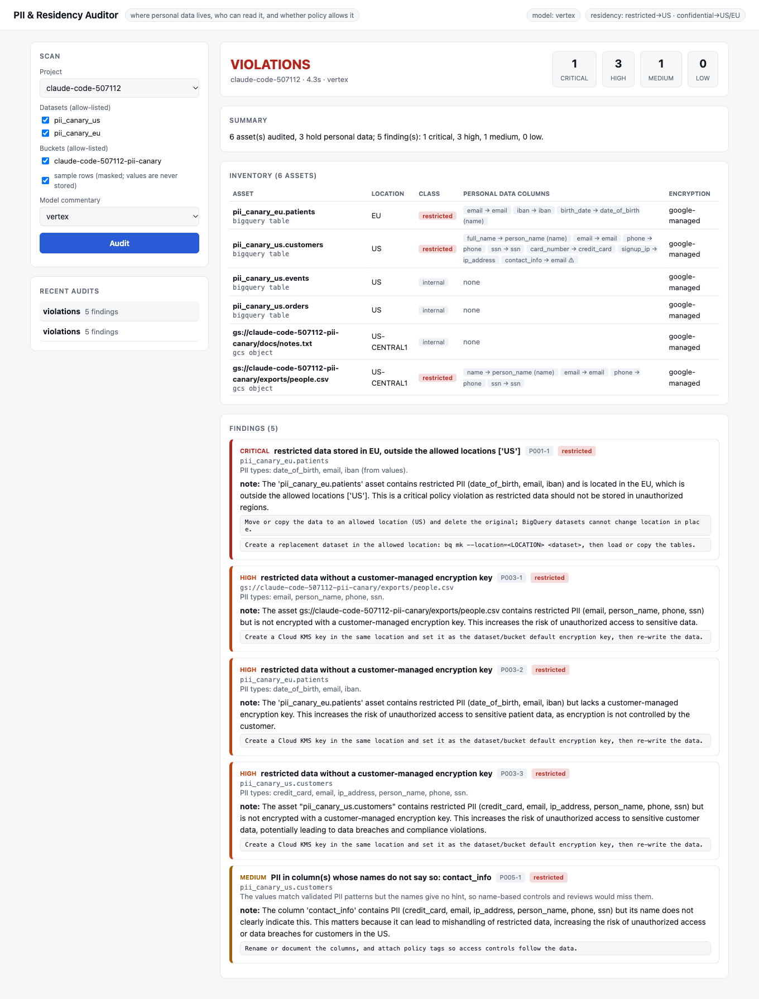

# gcp-data-residency-pii-auditor

Where does personal data actually live in your BigQuery and Cloud Storage, is it in a region your policy allows, who can read it, and is it encrypted the way you require?
This tool finds personal data by **validated value patterns plus column names**, then checks **residency, access, encryption and retention** against a policy you write. Raw values are
counted and dropped: reports contain column names, PII types, counts and masked examples only, and models see redacted metadata.



## What it does

| Step | How |
|---|---|
| Find PII | validated detectors for email, phone, US SSN (area rules), card numbers (Luhn), IBAN (mod 97), public IPv4; names, addresses, dates of birth and locations by column name. Samples the first 50 rows of native BigQuery tables and the first 64 KB of CSV/JSONL/TSV/text objects in allow-listed buckets |
| Classify | per column: `name+values`, `values`, `name_only`; data class public / internal / confidential / restricted; flags PII under names that do not say so (**P005**) |
| Check policy | **P001** residency (e.g. restricted data must stay in the US) · **P002** access (public / domain-wide / too many readers) · **P003** customer-managed encryption · **P004** retention |
| Explain (optional) | a model writes a short note from redacted metadata; rejected if it contains personal data, a link, another asset, or a false "public" claim |

Default policy: restricted data US-only, confidential data US or EU, CMEK required for restricted data, at most 10 readers on restricted data. Change it with `PII_POLICY` or `--policy`.

## Quick start

```bash
python3 -m venv .venv && .venv/bin/pip install -e ".[dev]"
.venv/bin/pii audit my-project --no-sample --llm none            # inventory by column names only; reads no data
.venv/bin/pii audit my-project --dataset customers --bucket my-bucket --policy policy.json; echo "exit=$?"   # 0 compliant, 1 attention, 2 violations
```

## Deploy to GCP

```bash
cp deploy.env.example deploy.env && ./scripts/up.sh && ./validation/plant.sh plant
gcloud run services proxy pii-auditor --region us-central1 --port 8081
./scripts/down.sh
```

Terraform creates APIs, Artifact Registry, a build identity, a runtime service account (`bigquery.metadataViewer`, `dataViewer` on the canary datasets only, `objectViewer` and `legacyBucketReader` on the canary bucket only,
`iam.securityReviewer`, `aiplatform.user`), a private Cloud Run service (one invoker, no `allUsers`) with project/dataset/bucket allow-lists, and the canary data used for validation.

Docs: [architecture](docs/architecture.md) · [threat model](docs/threat-model.md) · [runbooks](docs/runbooks/) · [ADRs](docs/adr/) · [**validation**](docs/validation-results.md) · [model eval](docs/eval-results.md)

## Verification

| Check | Result |
|---|---|
| Offline tests | 60 pass: each validator (valid and invalid values), masking, classification (values vs names, flags, types), policy and access levels, every finding rule, no-leak properties across report, API, CLI and model payload, note validation, scope limits |
| **Planted canaries in real BigQuery and GCS** | **14 of 14** planted PII columns found across 3 assets; 0 false positives among the other columns and benign assets; residency, encryption and undocumented-PII findings fired as expected; local and deployed results identical |
| A real dataset (`lakehouse`) | the first run reported a false positive (`is_credit_card` is a payment flag); fixed with type-aware classification and regression tests, after which the dataset audits as having no personal data |
| Model eval (mock, gemini-2.5-flash, gpt-5-nano) | findings identical to the model-free run; **no personal value was ever sent to a model** (audited); no unclean note kept (one gpt-5-nano note rejected) |
| Deployed | unauthenticated = 403; `openai` = 403; other project = 403; other dataset = 403; response bodies contain no planted value |

## Limits

- Sampling is the first 50 rows / 64 KB, not a statistical sample: rare PII deeper in a table is missed, and a name-only classification (unsampled, external tables and views) is low confidence.
- Value validators cover email, phone, SSN, card, IBAN and public IPv4. Names, addresses, dates of birth and geolocation are recognised from column names only, and free-text columns are not searched for embedded PII beyond these patterns. This is not a replacement for Cloud DLP.
- Residency is the dataset's or bucket's location, not data lineage: copies, exports and caches elsewhere are not found.
- Access is read from dataset ACL entries and bucket public access. It does not expand group membership, evaluate project-level IAM roles on datasets, authorized views, policy tags or row-level security, so a restricted table protected by policy tags can still be reported.
- The domain-wide-access rule could not be canaried live (BigQuery rejects invalid domains and a real one could belong to someone); it is covered by unit tests only.
- Phone and SSN formats are US-centric; other national IDs are not validated.
